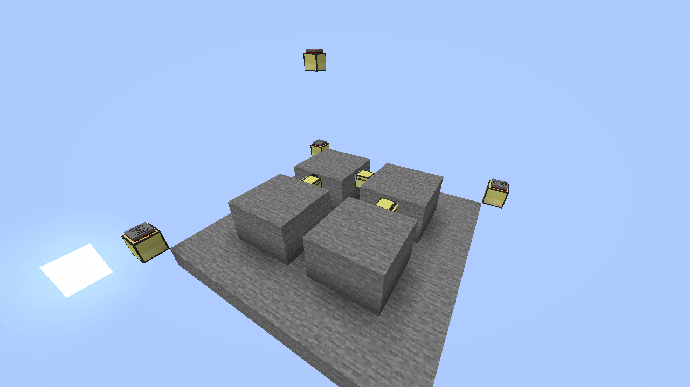

# SSOT PR 1 evidence

The retained results cover a four-million-byte computer disk, three moving turtles, map paging, authenticated requests, storage failures, and restart reconciliation. Full run directories are outside the repository.

## Gate A

Run commands from the repository root:

```powershell
C:\Tools\lua52\lua52.exe tests\run.lua
powershell -NoProfile -ExecutionPolicy Bypass -File tests\sandbox\run.ps1 -Scenario ssot -Seconds 900 -Output C:\Work\gemini-input\p2\evidence\pr1\gateA\diagnostic
powershell -NoProfile -ExecutionPolicy Bypass -File tests\sandbox\run.ps1 -Scenario smoke -Seconds 120 -Output C:\Work\gemini-input\p2\evidence\pr1\gateA\smoke
powershell -NoProfile -ExecutionPolicy Bypass -File tests\review-capture.ps1 -Output C:\Work\gemini-input\p2\evidence\pr1\gateA\hub-capture
```

The mocks report 94 passing tests and ten SSOT checks. `gateA/baseline.txt` preserves the original capacity-fixture failure. The fixture now reserves its intended free space after accounting for the current script registry.

The SSOT scenario has a server, controller, three turtle emulators, and one shared physical world. Its occupancy check rejects overlapping physical moves. `checks.log` records the packet, token, replay, paging, and storage assertions. The storage tests inject failures at open, write, close, readback, rotation, and promotion. A separate 32-byte free-space case checks preflight rejection. The native server disk-fill case leaves at most 16 KiB free.

CraftOS-PC 2.8.3 intermittently fails concurrent BIOS startup and stalls during native peripheral reinitialization. The runner serializes boot and uses one CPU. Checkpoint crashes restart the Lua program in the same emulated computer. The final checkpoint kills and restarts the entire CraftOS process, including the shared world. Gate B uses actual CC computer reboots. The [CraftOS BIOS reader](https://github.com/MCJack123/craftos2/blob/v2.8.3/src/Computer.cpp#L192) has a shared static read buffer.

The review probes and `hub-current.png` exercise the imported review helpers. The hub image is an actual CraftOS framebuffer from the existing idle hub.

## Gate B

```powershell
powershell -NoProfile -ExecutionPolicy Bypass -File tests\ingame\run.ps1 -Scenario ssot -Client -Output C:\Work\gemini-input\p2\evidence\pr1\gateB\accepted-final
```

The disposable world is `C:\Work\mc-ssot-pr1-218dc2b9`, on Minecraft loopback port 60780. The runner shuts it down after collection. `jar-sha256.txt` records the installed jars, including CC:Tweaked 1.120.2, Classic Peripherals 0.6.5, and the supplied turtlebattery 0.3.0 build. `configuration.txt` records the disk, thread, and modem settings.

The three real turtles record 17 adjacent moves across all six directions. The timeline verifier finds zero occupied-cell overlaps. RCON independently checks their final block entities. The fixture reboots turtle 1 before and after a physical movement, reboots the server computer mid-reservation, and restarts the full Minecraft server. A startup hold keeps the workers stopped until the runner restarts the GPS hosts. GPS supplies their observed boot coordinates.

`durable-state.txt` checks the latest SOLID scan revision and the empty reservation set after restart. `offline-occupancy.txt` checks that unloading the controller chunk preserves its occupied cell. The controller shuts down and loses its modem before that unload, so its previous ender modem cannot answer the ordinary-modem probes during reload. Both ordinary endpoints received replies through the configured mesh, including the Nether endpoint, with `enderModemNerf=false`.

`ssot-crossing.png` is an F2 screenshot from the offline `SSOTProof` client on the logged-in Windows desktop. `position-timeline.png` is a separate diagram from the recorded coordinates.



## Measurements and source identity

Both gates record 1,000 and 10,000 observations, then reach the configured eight-chunk bound with 10,004 cells. The ninth chunk fails without eviction. Generation sizes include eight cached request results; they shrink when large scan requests leave that cache. These are acceptance diagnostics on a busy VM, not a throughput claim for the default 64-chunk limit.

CraftOS reports its Lua heap. Minecraft's Cobalt runtime does not expose `collectgarbage`; its metrics mark that value unavailable. `java-heap.txt` records the actual server JVM heap instead.

The seven changed production Lua files match the staged files in both gates after LF normalization. `source-sha256.txt` records the repository source. The Minecraft fixture was staged before the sandbox-only restart handling was added to two shared test helpers. Their Minecraft behavior is unchanged; `gateB/staged-helper-sha256.txt` records those exact staged copies.

The full archives retain states and failed attempts under `C:\Work\gemini-input\p2\evidence\pr1\`. Curated text uses UTF-8 and LF without trailing whitespace. This subset excludes launcher arguments, RCON passwords, and jars. See the [decision trail](../../ssot-pr1-decisions.tsv) for the failed runs and corrections.
