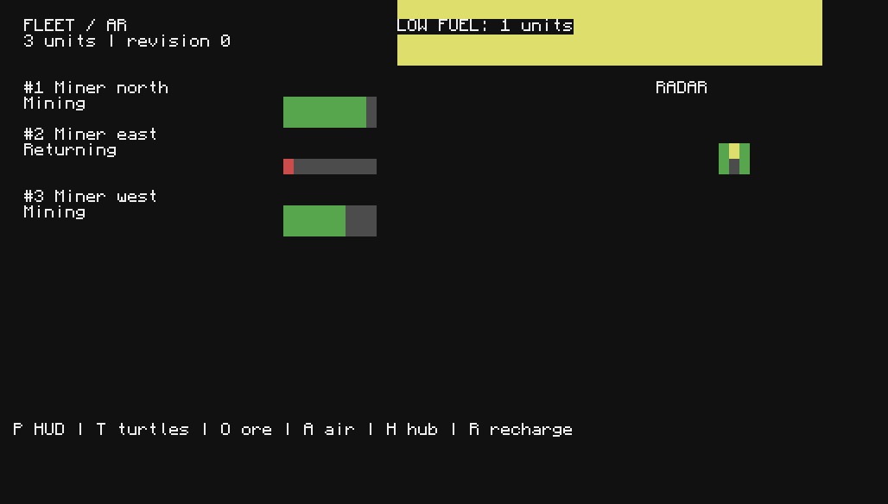

# PR 6 evidence

Gate A passed for bundle `8152c067`. Gate B is incomplete.

The final mock run passed 116 registered tests and the standalone SSOT, navigation, mining, and AR checks. See [mocks-final.log](mocks-final.log). The updater transport regressions include a failing run before the fixture correction in [regression-checks.txt](regression-checks.txt).

The final CraftOS run used six computers, three turtle emulators, virtual modems, and a 4,000,000-byte disk limit. It exercised the production server and hub, detach and reattach, server ownership recovery, and a complete CraftOS process restart. See [coverage.json](gateA/coverage.json) and [sandbox.log](gateA/sandbox.log). The run directory is `C:\Work\sbx-pr6\b6898016b8e54c0daa799219bc172ded`.

```powershell
C:\Tools\lua52\lua52.exe tests\run.lua
powershell -NoProfile -ExecutionPolicy Bypass -File tests\sandbox\run.ps1 -Scenario ar -Seconds 900 -DataRoot C:\Work\sbx-pr6 -Output C:\Work\gemini-input\p2\evidence\pr6\gateA\final-shared
```

The sandbox uses strict cc_ar mocks and module-level chat and installation fault injection. Its owners have separate controller stores. `tests/ar-shared-owner.lua` separately proves stale element removal against one shared store. That regression failed before the ownership fix. The native shared-controller checks also passed in `native-priority`.



This is a CraftOS screenshot of the emulated HUD, not a Minecraft goggles screenshot. It was captured before the final ownership cleanup change, which does not change the layout.

The first native attempt used `C:\Work\mc-ssot-pr6-8a9ce730`, ports 50882 and 50883, and the pinned installed mods. The server timed out during world startup before RCON became ready. No Lua probes or client screenshots ran. Its logs are in `C:\Work\gemini-input\p2\evidence\pr6\gateB\native-final`.

The next attempt booted, but a shared transcript file blocked fixture setup. The runner now retries transcript writes. The fresh retry in `C:\Work\mc-ssot-pr6-cff7c78d`, ports 51342 and 51343, passed native rendering and Minecraft restart recovery. Its actual controller held 95 elements, unchanged frames made zero drawing calls, scoped cleanup preserved a foreign element, and all three real turtles moved. These results use a renderer fixture. They do not yet prove the production owner or chat paths.

That client's NeoForge loading window timed out before Minecraft joined. The ownership phase then stopped when a temporary empty status file parsed as null. Both saved owner records still report `ok=true`. The runner now retries empty records and allows the server to finish its startup hashes. The next attempt disables the early loading window only in the isolated AR client configuration.

```powershell
powershell -NoProfile -ExecutionPolicy Bypass -File tests\ingame\run.ps1 -Scenario ar -Client -Timeout 1800 -Output C:\Work\gemini-input\p2\evidence\pr6\gateB\native-retry
```

The `native-priority` run passed rendering, Minecraft restart recovery, and production ownership checks against one real controller. Server death, hub takeover, server reclaim, forwarded keys, detach, replacement, stale namespace cleanup, and preservation of a foreign namespace passed. See [owner-result.json](gateB/native-priority/owner-result.json).

The real client joined with linked goggles and captured [ar-hud.png](gateB/native-priority/ar-hud.png) and [ar-xray.png](gateB/native-priority/ar-xray.png). The HUD is visible. The wall screenshot has no visible 3D geometry and does not prove x-ray rendering. The AP test sent `confirm pro` because its regex matched the prompt before the command token. The parser now requires `$confirm` or `!confirm`. Both issues need another real-client check.

The native runner keeps renderer, client, and production ownership results separate. Screenshot files alone cannot pass the complete gate. Production recall and charging, all-role installation, and storage integration still need real-game verification.

PR 4 supplies the charging and warehouse boundary. PR 5 supplies view roles and the separate hub's ore snapshot. Those adapters report unavailable in this independent branch. Configured AR bounds record intent; the miner's existing mine and navigation bounds enforce movement limits.

The allowlist starts empty. Verified UUIDs must be enrolled locally. The updater has manual offline repair after interrupted file promotion; automatic reboot recovery is not claimed.
